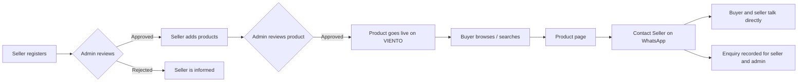
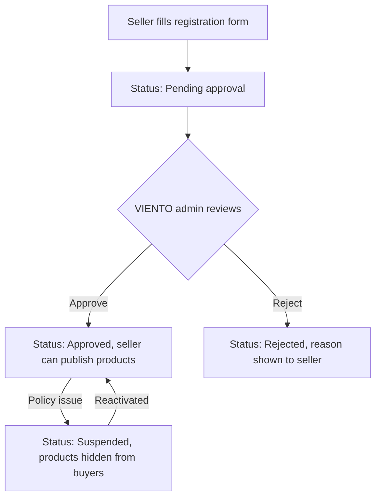

# VIENTO Marketplace — Project Proposal

**Prepared for:** VIENTO
**Document type:** Proposed application flow, for client approval
**Version:** 1.0 (draft)
**Date:** 21 November 2026

---

## 1. What we are building

VIENTO will become an **online marketplace** where many independent sellers list their products on one website, and buyers browse them all in one place, much like Meesho or Flipkart.

The key difference from a normal online shop is **how buyers purchase**:

> A buyer finds a product → taps **"Contact Seller on WhatsApp"** → WhatsApp opens with a ready-made message to **that product's seller** → the buyer and seller finalise the deal directly.

VIENTO does not handle payments or delivery in this phase. It is the shop window that connects buyers to the right seller instantly.

### Example

| Seller | Products listed |
|---|---|
| Seller A — Jaipur Décor House | 50 products |
| Seller B — Kitchen Essentials | 100 products |
| Seller C — ToolMart | 200 products |

A buyer visiting VIENTO sees all **350 products** together and can search, filter and compare them. When they contact a seller about a product, the message goes to **that seller's own WhatsApp number**, not to VIENTO.

---

## 2. Who uses the application

| User | What they do | Login needed? |
|---|---|---|
| **Buyer** (public visitor) | Browses, searches and contacts sellers on WhatsApp | **No.** Browsing is completely open |
| **Seller** | Registers a shop, lists products, manages stock and enquiries | Yes, after VIENTO approves the shop |
| **Admin** (VIENTO team) | Approves sellers and products, manages categories, the homepage and settings | Yes |

---

## 3. Overall flow



---

## 4. Buyer journey (public website)

### 4.1 Steps

1. **Open VIENTO.** The homepage shows banners, categories, featured products, new arrivals and popular sellers.
2. **Find a product** by:
   - typing in the **search bar** (product name, category or seller), or
   - tapping a **category** (e.g. *Home Decoration → Cushion Covers*).
3. **Narrow the results** using filters (category, price range, seller, in-stock only) and sorting (newest, price low to high, price high to low).
4. **Open a product** to see large photos, price, discount, description, specifications, stock status and seller details.
5. **Tap "Contact Seller on WhatsApp".** WhatsApp opens on the phone (or WhatsApp Web on a computer) with this message already typed:

   ```
   Hello, I am interested in the following product:

   Product: VIENTO Poly Sealing Machine 12" (Orange)
   Product ID: VNT-HS12-OR
   Price: ₹1,499
   Seller: VIENTO Official Store

   Please share more details.
   ```

6. The buyer presses **Send** and continues the conversation with the seller directly.

### 4.2 Buyer pages

| Page | Purpose |
|---|---|
| Homepage | Banners, Shop by Category, Featured Products, Recently Added, Popular Sellers, promotions |
| Category page | All products in a category and its subcategories, with filters |
| Search / All products | Search results with filters, sorting and page numbers |
| Product details | Gallery, price, description, specifications, seller card, WhatsApp button, related products |
| Seller shop page | One seller's profile and all their live products |
| Become a Seller | Seller registration form |
| About, Contact, Policies | Information pages |

### 4.3 What every product card shows

Product photo · name · price · discount (if any) · seller/shop name · stock status · **View Details** button.

### 4.4 Mobile first

Most buyers will use a phone, so the design starts from the mobile layout and is then adapted for tablet, laptop and desktop. On mobile the WhatsApp button stays visible at the bottom of the product page.

---

## 5. Seller journey

### 5.1 Registration and approval



**Registration form:** full name · business/store name · email · mobile number · **WhatsApp number** · business address · city · state · PIN code · business description · logo/profile photo · password.

- The **WhatsApp number is mandatory**, because every buyer enquiry goes to it.
- A seller can log in while **Pending**, but **only approved sellers can publish products**.
- If a seller is **suspended**, all their products are hidden from buyers right away and no new WhatsApp enquiries can reach them.

### 5.2 Seller dashboard

| Section | What the seller can do |
|---|---|
| **Dashboard** | See total, active, pending and out-of-stock products, total enquiries and recent enquiries |
| **Products** | Add, edit and delete products. Upload multiple photos, choose category and subcategory, set name, SKU, brand, description, specifications, price, discounted price, stock and variants (e.g. colour or size). Request "Featured" placement |
| **Inventory** | Update stock quantities, mark items out of stock, switch a listing on or off |
| **Enquiries** | See who enquired about which product and when (name and phone when the buyer shared them). Mark each enquiry **New → Contacted → Resolved** |
| **My Store** | Update shop profile, logo, description, business details and WhatsApp number |

A seller can **only see and change their own shop and products**. The system blocks access to any other seller's data.

### 5.3 Product approval

Products created by sellers start as **Pending review**. Admin approves them before they appear to buyers. (The admin can turn on "auto-approve" for trusted sellers.)

| Product status | Visible to buyers? |
|---|---|
| Draft | No |
| Pending review | No |
| Approved / Live | **Yes** (if the seller is approved and the category is active) |
| Rejected | No (reason shown to the seller) |
| Disabled by seller | No |

---

## 6. Admin (VIENTO team) journey

| Section | What the admin can do |
|---|---|
| **Dashboard** | Totals for sellers, active sellers, pending approvals, products (total, pending, active), categories and enquiries |
| **Sellers** | View all sellers, see each seller's details and products, then approve, reject, suspend or reactivate |
| **Categories** | Add, edit or delete categories and subcategories. Upload image and icon, set colour, control display order, show or hide |
| **Products** | View all products, filter by seller, category or status, approve or reject, edit, remove, mark as Featured |
| **Homepage** | Manage hero banners and promotional sections, choose featured categories and products, set display order |
| **Enquiries** | View all marketplace enquiries, filter by seller or product, see enquiry statistics |
| **Settings** | Marketplace name and logo, contact details, social media links, default WhatsApp message, website settings |

Everything a buyer sees (categories, banners, featured products, sellers) is **controlled from this admin panel**. Adding a new seller or a new category such as *Electronics* or *Fashion* needs **no developer work**.

---

## 7. Product categories

The admin panel manages unlimited categories, and each can have subcategories. We will start with:

| Category | Example subcategories |
|---|---|
| **Home Decoration** | Cushion Covers, Table Runners & Placemats, Gifts |
| **Power Tools** | Sealing Machines, Air Blowers, Spare Parts |
| **Home and Kitchen** | Dinnerware & Thalis, Kitchen Essentials |

More categories (Electronics, Fashion, Furniture, Gifts, Accessories…) can be added at any time from the admin panel.

Each category gets its **own colour and icon**, so the site looks lively and multicolour while keeping a consistent VIENTO look.

---

## 8. WhatsApp contact: how it works and what is protected

- The button always uses the **WhatsApp number of the seller who owns the product**, never VIENTO's number.
- Numbers are stored with the country code (e.g. +91 98765 43210) and checked when the seller registers.
- The button is **shown only** when the product is live, the seller is approved, and the category is active. Suspended sellers and hidden products cannot receive new enquiries.
- Each click is recorded as an **enquiry** so the seller and admin can see interest per product.
- Sellers' email addresses and home addresses are **not shown** to buyers. Only the shop name, city and WhatsApp contact button are shown.
- Email is **not** used as the contact method.
- No paid WhatsApp Business API is needed. The standard free "click to chat" link is used.

---

## 9. Design direction

- **Look:** colourful, premium and clean, with original VIENTO branding (inspired by, not copied from, Meesho, Amazon and Flipkart).
- **Header:** VIENTO logo, large search bar, category menu, "Become a Seller" link.
- **Homepage:** hero banner carousel → Shop by Category → Featured Products → Promotional banners → Recently Added → Popular Sellers → Footer.
- Rounded cards, soft shadows, clear prices and discounts, a prominent **green WhatsApp button**.
- Fast loading: images load as you scroll, and products load page by page, so the site stays quick with thousands of products.

---

## 10. What is included now and what is planned for later

### Included in this project

- Public buyer website (no login needed)
- Seller registration, approval and seller dashboard
- Admin dashboard with full marketplace control
- Category and subcategory management
- Products with photos, specifications, variants and stock
- WhatsApp contact with the respective seller, plus enquiry tracking
- Homepage, banner and settings management
- Search, filters, sorting and pagination
- Secure logins for sellers and admins
- Responsive design for mobile, tablet and desktop

### Planned for later (the system is designed to allow these, but they are not built now)

Online cart and checkout · online payments · seller commissions and payouts · order management · shipping and order tracking · customer accounts · reviews and ratings · coupons · seller subscription plans.

---

## 11. Project phases

| Phase | Deliverable | Client can review |
|---|---|---|
| 1 | Analysis and this proposal | **This document** |
| 2 | Backend and database (secure server, data storage, logins) | Admin and seller logins working |
| 3 | Buyer website upgrade (new homepage, categories, product pages, search) | Live preview link |
| 4 | Seller registration and seller dashboard | Test seller account |
| 5 | Admin dashboard | Admin account |
| 6 | WhatsApp integration and enquiries | Test on phone and desktop |
| 7 | Testing, speed optimisation, go-live | Final sign-off |

Each phase ends with a demo for client feedback before the next one starts.

---

## 12. Decisions needed from the client

Please confirm or comment on each point:

1. **Current demo cart and checkout.** The current demo site has a cart and checkout (no real payment). Choose one:
   - (a) **Hide it for now** and use WhatsApp only, keeping it ready to switch on later *(recommended)*
   - (b) Keep it visible alongside WhatsApp
   - (c) Remove it completely
2. **Product approval.** Should every seller product need admin approval before going live? *(Recommended: yes, with an optional auto-approve for trusted sellers.)*
3. **Enquiry details.** Should we ask buyers for an optional name and phone number before opening WhatsApp, so sellers see them in the dashboard? *(Recommended: optional, never mandatory.)*
4. **VIENTO's own products.** Should VIENTO's current products be listed under a "VIENTO Official Store" seller account? *(Recommended: yes.)*
5. **Hosting.** Will VIENTO provide the server, database and domain, or should we recommend a provider (e.g. Microsoft Azure)?
6. **Content.** Please supply the logo files, banner images, category images, and the WhatsApp number for the VIENTO Official Store.
7. **Seller fees.** Will sellers be charged anything (registration or subscription)? Not built now, but it affects future planning.

---

## 13. Approval

| | Name | Signature | Date |
|---|---|---|---|
| Client (VIENTO) | | | |
| Project lead | | | |

**Comments / change requests:**

&nbsp;

&nbsp;
