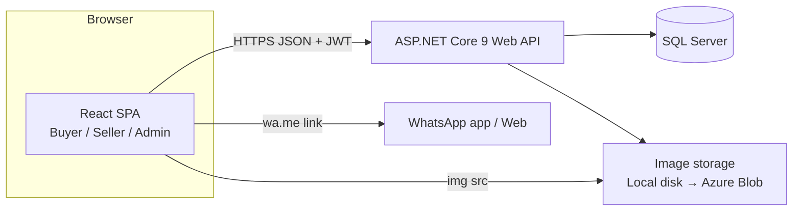
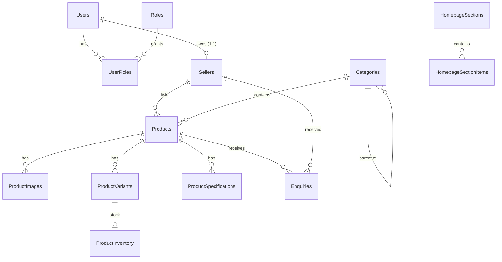

# VIENTO Marketplace — Technical Implementation Plan

**Audience:** developers and technical reviewers
**Status:** Draft. Implementation waits for client approval of `VIENTO-Marketplace-Proposal.md`
**Date:** 21 November 2026

---

## 1. Current-state analysis (Phase 1)

### 1.1 Stack

| Layer | Today |
|---|---|
| Frontend | React 19, TypeScript, Vite 8, Tailwind CSS 4, React Router 7, lucide-react |
| Backend | **None** |
| Data | `localStorage` through `src/services/mockDb.ts` (products, orders, categories, sellers) |
| Auth | Admin credentials checked in the browser (`authService.ts`), which is not a security boundary. Customer "accounts" are also in localStorage |
| Hosting | Vercel (static), `https://vientos.vercel.app/` |
| Assets | `Public/images/**` (`vite.config.ts` sets `publicDir: 'Public'`) |

Local tooling available: .NET SDK 9 and 10, SQL Server Express (running), LocalDB, Node 20.

### 1.2 Structure

```
src/
  types/index.ts          Domain models (Category, Seller, Product, Order…), written to mirror future API DTOs
  data/seed.ts            12 categories, 3 sellers, ~20 products, seed orders
  services/               productService, categoryService, sellerService, orderService,
                          authService, customerAuthService (async, API-shaped). mockDb.ts = storage
  context/                StoreContext (loads the ENTIRE catalogue), CartContext, ToastContext,
                          AdminAuthContext, CustomerAuthContext
  components/ui           Logo, Spinner, PageLoader, ErrorState, EmptyState, SkeletonCard,
                          ProductImage, StockBadge, QuantitySelector, Field, Modal, ConfirmDialog, Breadcrumbs
  components/marketplace  CategoryIcon/Bubble/Label/Chip, SellerAvatar, SoldBy, SellerStatusBadge, tint()
  components/product      ProductCard, ShopCard, OrderTimeline
  components/home         HeroBanner, HomeSections
  components/layout       StoreLayout (header/footer/nav), AdminLayout (+ RequireAdmin)
  components/admin        ProductFormModal, SalesChart
  pages/store             Home, Products, Collection, ProductDetail, Cart, Checkout, OrderConfirmation,
                          Orders, AccountAuth, Info, Misc, SellerPages (/sell, /sellers/:slug)
  pages/admin             Login, Dashboard, ProductsAdmin, Inventory, OrdersAdmin, SellersAdmin, CategoriesAdmin
```

### 1.3 What already exists and can be reused

| Item | Reuse decision |
|---|---|
| `types/index.ts` models | **Extend.** Add `parentId`, `slug`, product `status`, variants, `whatsappNumber`, enquiries, banners, settings |
| Service layer pattern (one file per resource, endpoint documented) | **Keep the signatures where possible** and replace the `db.*` bodies with `fetch` through a shared `apiClient` |
| UI kit (`components/ui`, `components/marketplace`) | **Reuse as-is**. These are the base for seller and admin dashboards |
| `ProductCard` / `ShopCard` | **Adapt**: add seller name, View Details, make the WhatsApp/cart CTA depend on a setting |
| `ProductDetailPage` | **Adapt**: gallery and specs reused. Add WhatsApp CTA, variants, seller card from API |
| Category colour/icon system | **Keep**. It is the source of the multicolour identity |
| Seller status workflow (`pending/approved/rejected/suspended`) | **Keep the semantics** and move enforcement server-side |
| Admin pages (Sellers, Categories, Products, Inventory, Dashboard) | **Adapt** to server-paged APIs |
| `/sell` application form | **Extend** into full seller registration (password, WhatsApp, address, logo) |
| Cart / Checkout / Orders / customer login | **Pending client decision.** Recommended: keep the code, hide it behind the `Features.CartEnabled` platform setting (default off) |

### 1.4 Gaps compared with the requirements

1. No API, database, real authentication, or role-based authorisation.
2. No seller login or seller dashboard.
3. No subcategories, product variants, product approval status, enquiries, banners or platform settings.
4. Sellers have no WhatsApp number, and no WhatsApp CTA exists.
5. `StoreContext` loads all products into the browser, so there is no server-side search, filter, sort or pagination.
6. No image upload pipeline (images are URLs or base64 in localStorage).
7. Hard-coded demo content in `seed.ts`, `HeroBanner`, `HomeSections` and `InfoPages` must become data-driven.

---

## 2. Target architecture



- **One repository**: the frontend stays at the repo root, and a new `server/` folder holds the .NET solution. The SPA is not rebuilt.
- **Data access: EF Core (SQL Server provider).** The project has no existing data-access convention. EF Core gives versioned migrations, LINQ for dynamic filter and sort queries, and `dotnet ef migrations script` produces the SQL scripts deliverable. Dapper is **not** added alongside it. If raw SQL is ever needed for heavy reports, it goes through `FromSql`/`SqlQuery` in EF.
- **Layered (Clean-lite) architecture:**

```
server/
  Viento.sln
  src/
    Viento.Domain/          Entities, enums, value objects (PhoneNumber), domain rules. No dependencies
    Viento.Application/     DTOs, validators (FluentValidation), service interfaces + implementations,
                            authorisation policies, paging/filter models, mapping
    Viento.Infrastructure/  EF Core DbContext, configurations, migrations, seed, repositories (if needed),
                            BCrypt hasher, JWT token service, IImageStorage implementations
    Viento.Api/             Controllers, middleware (exception → ProblemDetails, logging), auth setup,
                            Swagger, CORS, rate limiting, static file serving for local images
  tests/
    Viento.Application.Tests/   unit tests (validators, WhatsApp link builder, status rules)
    Viento.Api.Tests/           integration tests (WebApplicationFactory + SQL Server/LocalDB test DB)
  database/
    schema.sql              generated from migrations (idempotent)
    seed.sql                sample categories, sellers, products
```

**NuGet packages (kept to a minimum):** `Microsoft.EntityFrameworkCore.SqlServer`, `Microsoft.EntityFrameworkCore.Design`, `Microsoft.AspNetCore.Authentication.JwtBearer`, `BCrypt.Net-Next`, `FluentValidation.AspNetCore`, `Swashbuckle.AspNetCore`, `libphonenumber-csharp` (phone validation), `SixLabors.ImageSharp` (resize to thumbnails/WebP). Also `Azure.Storage.Blobs`, but only when blob storage is enabled. Tests use `xUnit` and `Microsoft.AspNetCore.Mvc.Testing`.

**Frontend:** no new runtime dependencies are planned. `fetch` is wrapped in `src/services/apiClient.ts`. A small `usePagedQuery` hook is written in-house instead of adding React Query. That decision can be revisited if caching needs grow.

---

## 3. Database design (SQL Server)

Conventions:
- `Id` is `INT IDENTITY` for internal keys.
- Public-facing products also have a `PublicId` (`CHAR(10)`, e.g. `VNT8F3K2QX`) shown as "Product ID" in WhatsApp messages, so internal IDs are not leaked or enumerable.
- All tables have `CreatedAt`/`UpdatedAt` (`DATETIME2`, UTC). Business tables also have `CreatedBy`/`UpdatedBy` (`INT NULL` → Users.Id).
- Soft delete uses `IsDeleted BIT` + `DeletedAt` on Sellers, Products, Categories and Banners, with EF global query filters.
- Money is `DECIMAL(12,2)`. Status columns are `TINYINT` mapped to C# enums, with `CHECK` constraints.

### 3.1 ER overview



### 3.2 Tables

**Users**
| Column | Type | Notes |
|---|---|---|
| Id | INT PK | |
| Email | NVARCHAR(256) | **UNIQUE** (normalised lower-case) |
| PasswordHash | NVARCHAR(100) | BCrypt, work factor 12 |
| FullName | NVARCHAR(150) | |
| MobileNumber | VARCHAR(16) | E.164 |
| IsActive | BIT | |
| LastLoginAt | DATETIME2 NULL | |
| FailedLoginCount, LockoutEndAt | INT, DATETIME2 NULL | brute-force lockout |
| SecurityStamp | UNIQUEIDENTIFIER | rotated on password/role change, used to invalidate refresh tokens |
| CreatedAt, UpdatedAt | | |

**Roles** (`Id`, `Name` UNIQUE): seeded with `Admin`, `Seller`. `Buyer` is reserved for future customer accounts.
**UserRoles** (`UserId`, `RoleId`): composite PK.
**RefreshTokens** (`Id`, `UserId`, `TokenHash`, `ExpiresAt`, `RevokedAt`, `CreatedByIp`): enables short-lived access tokens.

**Sellers**
| Column | Type | Notes |
|---|---|---|
| Id | INT PK | |
| UserId | INT FK → Users | **UNIQUE** (one account, one shop) |
| StoreName | NVARCHAR(150) | **UNIQUE** (filtered on `IsDeleted = 0`) |
| Slug | VARCHAR(160) | **UNIQUE** |
| ContactName | NVARCHAR(150) | |
| Email, MobileNumber | | private, never returned on public endpoints |
| WhatsAppNumber | VARCHAR(16) | **E.164, required**, validated with libphonenumber |
| AddressLine, City, State, PinCode | NVARCHAR / CHAR(6) | address private. City/State public |
| Description | NVARCHAR(2000) | |
| LogoUrl | NVARCHAR(500) NULL | |
| BrandColor | CHAR(7) | avatar colour (existing feature) |
| Status | TINYINT | 0 Pending, 1 Approved, 2 Rejected, 3 Suspended |
| StatusReason | NVARCHAR(500) NULL | shown to the seller |
| StatusChangedAt, StatusChangedBy | | audit |
| IsOfficial | BIT | VIENTO Official Store cannot be suspended |
| AutoApproveProducts | BIT | trusted-seller flag |
| CommissionRate | DECIMAL(5,2) | kept from the current model for future use |
| GSTIN | VARCHAR(15) NULL | |
| IsDeleted, DeletedAt, audit fields | | |

Indexes: `IX_Sellers_Status`, `UX_Sellers_Slug`, `UX_Sellers_UserId`.

**Categories** (self-referencing hierarchy)
| Column | Type | Notes |
|---|---|---|
| Id | INT PK | |
| ParentId | INT NULL FK → Categories | NULL = top level |
| Name | NVARCHAR(100) | UNIQUE per parent |
| Slug | VARCHAR(120) | **UNIQUE** globally (clean URLs `/c/{slug}`) |
| Description | NVARCHAR(1000) | |
| ImageUrl, IconKey | NVARCHAR(500) NULL, VARCHAR(40) | icon key maps to the existing Lucide map |
| Color | CHAR(7) | category accent colour |
| DisplayOrder | INT | |
| IsActive | BIT | inactive parent hides its children and their products |
| IsFeatured | BIT | homepage "featured categories" |
| IsDeleted, audit | | delete is blocked while products reference the category |

Index: `IX_Categories_ParentId_DisplayOrder`. Depth is limited to **2 levels** (category → subcategory) by validation. The schema allows more if needed later.

**Products**
| Column | Type | Notes |
|---|---|---|
| Id | INT PK | |
| PublicId | CHAR(10) | **UNIQUE**, shown to buyers |
| SellerId | INT FK → Sellers | |
| CategoryId | INT FK → Categories | leaf or parent |
| Name | NVARCHAR(200) | |
| Slug | VARCHAR(220) | **UNIQUE** |
| SKU | VARCHAR(64) | **UNIQUE per seller** (`SellerId, SKU`) |
| Brand | NVARCHAR(100) NULL | |
| ShortDescription | NVARCHAR(300) | |
| Description | NVARCHAR(MAX) | |
| Price (MRP) | DECIMAL(12,2) | `CHECK > 0` |
| DiscountedPrice | DECIMAL(12,2) NULL | `CHECK <= Price` |
| EffectivePrice | computed persisted `COALESCE(DiscountedPrice, Price)` | used for price filtering and sorting |
| Status | TINYINT | 0 Draft, 1 PendingReview, 2 Approved, 3 Rejected |
| IsEnabled | BIT | seller on/off toggle |
| ModerationNote | NVARCHAR(500) NULL | |
| IsFeatured | BIT | set by admin |
| FeatureRequested | BIT | set by seller |
| HasVariants | BIT | |
| TotalStock | INT | denormalised sum of inventory, maintained in the same transaction |
| PublishedAt | DATETIME2 NULL | used for "Recently added" |
| Features | NVARCHAR(MAX) NULL | JSON array of bullet points (existing field) |
| IsDeleted, audit | | |

Indexes for the public listing (the hot path):
- `IX_Products_Listing (Status, IsEnabled, IsDeleted, CategoryId) INCLUDE (EffectivePrice, PublishedAt, TotalStock, SellerId)`
- `IX_Products_Seller (SellerId, IsDeleted, Status)`
- `IX_Products_Featured (IsFeatured) WHERE IsFeatured = 1`
- **Full-text index** on `Name, Brand, ShortDescription`, used once the catalogue is large. Until then the fallback is `LIKE 'term%'` on Name plus `CONTAINS` when FTS is installed (SQL Express supports FTS with Advanced Services; this is checked at startup).

**ProductImages** (`Id`, `ProductId` FK, `Url`, `ThumbnailUrl`, `AltText`, `Width`, `Height`, `SizeBytes`, `DisplayOrder`, `IsPrimary`). Index `(ProductId, DisplayOrder)`. Maximum 8 per product.

**ProductVariants** (`Id`, `ProductId` FK, `Sku` UNIQUE per product, `OptionsJson` e.g. `{"Colour":"Orange","Size":"12\""}`, `Price` NULL override, `DiscountedPrice` NULL, `IsActive`, `DisplayOrder`). A product without variants has **one default variant**, so inventory is always tracked at variant level.

**ProductInventory** (`VariantId` PK/FK, `QuantityAvailable` INT `CHECK >= 0`, `LowStockThreshold` INT, `RowVersion` ROWVERSION for optimistic concurrency, `UpdatedAt`).
**InventoryAdjustments** (`Id`, `VariantId`, `Delta`, `Reason`, `UserId`, `CreatedAt`): small audit trail of stock changes, useful when orders arrive later.

**ProductSpecifications** (`Id`, `ProductId` FK, `Label` NVARCHAR(100), `Value` NVARCHAR(500), `DisplayOrder`).

**Enquiries**
| Column | Type | Notes |
|---|---|---|
| Id | INT PK | |
| ProductId | INT FK | |
| SellerId | INT FK | copied at creation time, so history survives product edits |
| VariantId | INT NULL | |
| ProductNameSnapshot, PriceSnapshot | | |
| CustomerName | NVARCHAR(100) NULL | optional |
| CustomerPhone | VARCHAR(16) NULL | optional, E.164 |
| Channel | TINYINT | 0 WhatsApp (future: call, form) |
| Status | TINYINT | 0 New, 1 Contacted, 2 Resolved |
| SourceIpHash | VARBINARY(32) | SHA-256 of IP + salt, used for rate limiting and spam detection without storing raw IPs |
| UserAgent | NVARCHAR(300) | |
| CreatedAt, UpdatedAt | | |

Indexes: `(SellerId, CreatedAt DESC)`, `(ProductId)`, `(Status)`.

**HomepageBanners** (`Id`, `Title`, `Subtitle`, `ImageUrl`, `MobileImageUrl`, `LinkUrl`, `ButtonText`, `DisplayOrder`, `IsActive`, `StartsAt`, `EndsAt`, soft delete).

**HomepageSections** (`Id`, `Type` [FeaturedCategories | FeaturedProducts | RecentProducts | PopularSellers | PromoBanner], `Title`, `DisplayOrder`, `IsActive`, `ConfigJson`) and **HomepageSectionItems** (`SectionId`, `ItemType`, `ItemId`, `DisplayOrder`). Together these let the admin control homepage order and contents without code changes.

**PlatformSettings** (`Key` VARCHAR(100) PK, `Value` NVARCHAR(MAX), `IsPublic` BIT, `UpdatedAt`, `UpdatedBy`). Keys include `Site.Name`, `Site.LogoUrl`, `Contact.Email`, `Contact.Phone`, `Social.Instagram`, `WhatsApp.MessageTemplate`, `WhatsApp.DefaultCountryCode`, `Features.CartEnabled`, `Moderation.RequireProductApproval`.

**AuditLogs** (`Id`, `UserId`, `Action`, `EntityType`, `EntityId`, `DataJson`, `CreatedAt`) record admin moderation actions (approve, reject, suspend, feature, delete).

> Deliberately **not** created now: Orders, Payments, Carts, Reviews, Coupons, Subscriptions. The keys above (Products/Variants/Sellers) are the attachment points for them later.

### 3.3 Visibility rule (single source of truth)

A product is publicly visible **only if all of these are true**:

```
Product.Status = Approved AND Product.IsEnabled = 1 AND Product.IsDeleted = 0
AND Seller.Status = Approved AND Seller.IsDeleted = 0
AND Category.IsActive = 1 AND (Category.ParentId IS NULL OR Parent.IsActive = 1)
```

This is implemented once as an `IQueryable<Product>.PubliclyVisible()` extension and reused by listing, detail, related products, seller shop, homepage and **enquiry creation**.

---

## 4. Authentication and authorisation

- **Login:** `POST /api/auth/login` returns a short-lived **access JWT (15 min)** plus a **refresh token (14 days)**. The refresh token is sent as an `HttpOnly; Secure; SameSite=Strict` cookie and stored hashed in the DB.
- **JWT claims:** `sub` (UserId), `role`, `sellerId` (if Seller), `security_stamp`.
- **Policies:**
  - `AdminOnly` requires role Admin.
  - `SellerOnly` requires role Seller. Accessing an approved seller's publish actions also requires `Seller.Status = Approved`, checked in the service layer against the DB, not just the token.
- **Seller data isolation:** seller endpoints never take a `sellerId` from the client. It is resolved from the token (`ICurrentUser.SellerId`), and every query is filtered with `.Where(p => p.SellerId == currentSellerId)`. Attempting to edit another seller's product returns **404** (not 403), so IDs cannot be probed.
- **Passwords:** BCrypt (cost 12). Minimum 8 characters with letters and numbers. Lockout after 5 failures for 15 minutes.
- **Admin bootstrap:** the first admin is created from environment variables on first run (`Bootstrap__AdminEmail`, `Bootstrap__AdminPassword`). No credentials in the repo. The current demo credentials in `authService.ts` are removed.
- **Rate limiting** (ASP.NET Core built-in): login 10/min per IP, seller registration 5/hour per IP, enquiry creation 20/hour per IP.

---

## 5. REST API

Base path `/api`. JSON. Errors follow RFC 7807 `ProblemDetails` with a `errors` dictionary for validation. Paged responses have this shape:

```json
{ "items": [...], "page": 1, "pageSize": 24, "totalCount": 1340, "totalPages": 56 }
```

### 5.1 Public (no auth)

| Method | Endpoint | Purpose |
|---|---|---|
| GET | `/public/settings` | public platform settings (name, logo, social, cartEnabled) |
| GET | `/public/home` | banners + ordered homepage sections with their items (one call for the homepage) |
| GET | `/public/categories` | active category tree |
| GET | `/public/categories/{slug}` | category + children + breadcrumb |
| GET | `/public/products` | `?q=&category=&seller=&minPrice=&maxPrice=&inStock=&sort=latest\|price_asc\|price_desc&page=&pageSize=` (pageSize max 48). Category filter includes subcategories |
| GET | `/public/products/{slug}` | detail: images, specs, variants, stock status, public seller card, `whatsAppAvailable` flag |
| GET | `/public/products/{slug}/related` | same category, then same seller, up to 8 |
| GET | `/public/sellers` | approved sellers, `?sort=popular` (by live products / enquiries) |
| GET | `/public/sellers/{slug}` | public seller profile (no email/address/phone) |
| POST | `/public/enquiries` | `{ productPublicId, variantId?, customerName?, customerPhone? }` → validates visibility, records the enquiry, returns `{ whatsAppUrl }` |
| POST | `/auth/seller/register` | multipart: seller registration + logo |

### 5.2 Auth

`POST /auth/login` · `POST /auth/refresh` · `POST /auth/logout` · `GET /auth/me` · `POST /auth/change-password`

### 5.3 Seller (`SellerOnly`; all scoped to the current seller)

| Method | Endpoint |
|---|---|
| GET | `/seller/dashboard` (counts + 5 recent enquiries) |
| GET / PUT | `/seller/profile` (store info, WhatsApp, logo upload) |
| GET | `/seller/products?status=&q=&page=` |
| POST | `/seller/products` (status → PendingReview, or Approved if auto-approve; blocked unless seller Approved) |
| GET / PUT / DELETE | `/seller/products/{id}` (edit of an approved product's price/description re-queues review if the moderation setting requires it; soft delete) |
| PATCH | `/seller/products/{id}/enabled` |
| POST | `/seller/products/{id}/feature-request` |
| POST / DELETE / PATCH | `/seller/products/{id}/images`, `/images/{imageId}`, `/images/order` |
| GET | `/seller/inventory?lowStock=&page=` |
| PATCH | `/seller/inventory/{variantId}` `{ quantity, rowVersion }` |
| GET | `/seller/enquiries?status=&productId=&from=&to=&page=` |
| PATCH | `/seller/enquiries/{id}/status` |

### 5.4 Admin (`AdminOnly`)

| Area | Endpoints |
|---|---|
| Dashboard | `GET /admin/dashboard` |
| Sellers | `GET /admin/sellers?status=&q=&page=` · `GET /admin/sellers/{id}` · `POST /admin/sellers/{id}/approve \| reject \| suspend \| activate` (`{ reason }`) · `PATCH /admin/sellers/{id}` (auto-approve, commission) |
| Categories | `GET /admin/categories` (full tree incl. inactive) · `POST` · `PUT /{id}` · `DELETE /{id}` · `PATCH /admin/categories/order` · `POST /{id}/image` |
| Products | `GET /admin/products?seller=&category=&status=&q=&page=` · `GET/PUT/DELETE /{id}` · `POST /{id}/approve \| reject` · `PATCH /{id}/featured` |
| Homepage | CRUD `/admin/banners` · CRUD `/admin/home-sections` + `/items` · `PATCH /admin/home-sections/order` |
| Enquiries | `GET /admin/enquiries?seller=&product=&status=&from=&to=&page=` · `GET /admin/enquiries/stats` |
| Settings | `GET /admin/settings` · `PUT /admin/settings` |
| Uploads | `POST /admin/uploads` (generic image upload for banners, logo) |

Swagger UI is served at `/swagger` in Development. `docs/API.md` is generated from the same OpenAPI document.

---

## 6. WhatsApp integration

**Generated server-side** (`IWhatsAppLinkBuilder`), so the number is validated and the rules are enforced in one place, and the frontend never builds links from unchecked data.

1. **On save** (registration, profile update): parse with libphonenumber using the default region `IN`. The number must be valid and of type mobile, and is stored in E.164 (`+919876543210`).
2. **On enquiry** (`POST /public/enquiries`):
   - load the product with `PubliclyVisible()`. If it is not visible, return 404 (this covers suspended sellers and disabled products)
   - record the `Enquiry` row
   - render the template from `PlatformSettings["WhatsApp.MessageTemplate"]`:
     ```
     Hello, I am interested in the following product:

     Product: {ProductName}{VariantSuffix}
     Product ID: {PublicId}
     Price: {Price}
     Seller: {StoreName}
     Link: {ProductUrl}

     Please share more details.
     ```
   - build `https://wa.me/{digitsOnly}?text={Uri.EscapeDataString(message)}` (wa.me requires no `+`, spaces or dashes)
   - return `{ whatsAppUrl }`.
3. **Frontend behaviour:**
   - The button calls the endpoint, then calls `window.open(url, '_blank', 'noopener')`. On mobile, wa.me hands off to the app. On desktop it opens WhatsApp Web or prompts for the desktop app.
   - To avoid popup blockers, a blank window is opened synchronously on click and assigned the URL when the response arrives.
   - If the API call fails, the button shows an error toast. It does **not** fall back to a client-built link.
   - The optional name/phone capture (pending the client's decision) is a small bottom sheet with a "Skip" option.
4. The seller's raw WhatsApp number is **not** included in the public product JSON. It is only in the returned link at click time. This is light protection against bulk scraping, combined with rate limiting.
5. **Tests** cover E.164 normalisation (`09876543210`, `+91 98765-43210`, `919876543210` → `+919876543210`), rejection of landlines and invalid numbers, URL-encoding of `&`, `#`, `₹`, `"` and newlines, and the 404 for suspended or disabled products.

The Meta WhatsApp Business API is **not** used.

---

## 7. Image storage

- `IImageStorage` with `LocalDiskImageStorage` (dev and single-server deployments: `server/uploads/`, served at `/media/*` with long cache headers) and `AzureBlobImageStorage` (production, optionally fronted by a CDN). Selected by `Storage:Provider`.
- **Upload validation:**
  - JPEG, PNG or WebP only, checked by **magic bytes** and not just the extension. Maximum 5 MB.
  - Maximum 6000×6000 px. Re-encoded with ImageSharp, which strips EXIF and GPS data and neutralises polyglot files.
  - Stored as WebP at 1200 px (main) and 400 px (thumbnail).
  - Random file names (`{guid}.webp`) and no user-supplied paths.
- The DB stores URL and metadata only.
- Existing images in `Public/images/products` are referenced by URL in the seed data. Nothing is migrated into the DB.

---

## 8. Search, filtering and performance

- All listing endpoints are **server-paged** (default 24, max 48), with server-side filter and sort on indexed columns (`EffectivePrice`, `PublishedAt`).
- Queries use projection (`Select` into DTOs) and `AsNoTracking`. Images in listings return the primary thumbnail only.
- Search: `LIKE` prefix/contains on Name, Brand and Seller.StoreName, with `q` sanitised and parameterised by EF. Full-text search takes over automatically when the FTS index is present.
- Category filter: resolves the slug to `{id} ∪ childIds` (category tree cached in `IMemoryCache` for 5 minutes, invalidated on admin edits).
- `/public/home` and `/public/categories` are cached in memory (60 seconds) with `ETag` and `Cache-Control` headers.
- Response compression (Brotli/Gzip) is enabled.
- **Frontend:**
  - URL-driven filter state (`?q=&category=&page=`), so results are shareable and the back button works.
  - Debounced search (300 ms) and skeleton loaders.
  - `loading="lazy"` with explicit `width`/`height` on images, and `srcset` for thumbnail and main sizes.
  - Route-level code splitting with `React.lazy`, so the seller and admin dashboards are not shipped to buyers.
- `StoreContext` is retired as a "load everything" store and replaced by per-page data hooks plus a small `SettingsContext` (public settings and category tree).

---

## 9. Frontend changes

### 9.1 Routing (new and changed)

```
/                         Home (data-driven from /public/home)
/c/:slug                  Category (replaces /collections/:slug; old URL redirects)
/products                 Search & listing (server-paged)
/products/:slug           Product detail + WhatsApp CTA
/sellers                  All sellers
/sellers/:slug            Seller shop
/sell                     Seller registration (extends existing SellPage)
/login                    Unified login (seller/admin), role-based redirect

/seller                   SellerLayout + RequireRole('Seller')
  /seller                 Dashboard
  /seller/products        List · /new · /:id/edit
  /seller/inventory
  /seller/enquiries
  /seller/store           Store profile
  (pending/rejected/suspended sellers see a status screen with the reason)

/admin                    AdminLayout + RequireRole('Admin')
  /admin                  Dashboard
  /admin/sellers          (+ /:id detail)
  /admin/categories
  /admin/products         (+ approval queue tab)
  /admin/homepage         Banners & sections
  /admin/enquiries
  /admin/settings
```

Cart, checkout and order routes stay registered only when `cartEnabled` is true (if the client chooses option a).

### 9.2 Files: modified

| File | Change |
|---|---|
| `src/types/index.ts` | new DTO types matching the API, `PagedResult<T>`, enums as string unions |
| `src/services/*.ts` | bodies replaced with `apiClient` calls. Split into `public/`, `seller/` and `admin/` services |
| `src/context/StoreContext.tsx` | replaced by `SettingsContext` and page hooks. Removed after migration |
| `src/context/AdminAuthContext.tsx` | replaced by a single `AuthContext` (JWT, refresh, role) |
| `src/components/layout/StoreLayout.tsx` | search bar wired to `/products?q=`, category mega-menu from the API, footer from settings |
| `src/components/layout/AdminLayout.tsx` | new nav items. `RequireAdmin` → `RequireRole` |
| `src/components/home/HeroBanner.tsx`, `HomeSections.tsx` | render API banners and sections. Hard-coded content removed |
| `src/components/product/ProductCard.tsx`, `ShopCard.tsx` | merged into one `ProductCard` with variants (`compact`/`default`): seller name, discount, availability, View Details |
| `src/pages/store/ProductDetailPage.tsx` | API data, variant picker, `WhatsAppButton`, sticky mobile CTA |
| `src/pages/store/ProductsPage.tsx`, `CollectionPage.tsx` | server-paged listing with a shared `ProductListing` component and filter drawer on mobile |
| `src/pages/store/SellerPages.tsx` | full registration form (multipart). Shop page from API |
| `src/pages/admin/*` | rewired to paged admin APIs, plus approve/reject flows |
| `src/components/admin/ProductFormModal.tsx` | becomes a shared `ProductForm` used by both seller and admin (images, specs, variants) |
| `vite.config.ts` | dev proxy `/api` and `/media` → `https://localhost:7080` |
| `README.md` | setup instructions |

### 9.3 Files: new (main ones)

```
src/services/apiClient.ts            fetch wrapper: base URL, JWT header, refresh-on-401, ProblemDetails → ApiError
src/hooks/usePagedQuery.ts           URL-synced paging/filter state + loading/error
src/context/AuthContext.tsx, SettingsContext.tsx
src/components/whatsapp/WhatsAppButton.tsx, EnquirySheet.tsx
src/components/listing/ProductListing.tsx, FilterPanel.tsx, SortSelect.tsx, Pagination.tsx
src/components/forms/ImageUploader.tsx, SpecsEditor.tsx, VariantsEditor.tsx, PhoneInput.tsx
src/components/layout/SellerLayout.tsx
src/pages/seller/*                   Dashboard, Products, ProductEdit, Inventory, Enquiries, Store, StatusGate
src/pages/admin/HomepageAdminPage.tsx, EnquiriesAdminPage.tsx, SettingsAdminPage.tsx, SellerDetailPage.tsx
src/pages/store/LoginPage.tsx, SellersPage.tsx
.env.example                         VITE_API_BASE_URL
```

### 9.4 Design system

- Keep the existing navy/gold VIENTO tokens in `index.css` as the brand base. Category accent colours (already data-driven) provide the multicolour layer through chips, bubbles, section headers and tile backgrounds using `tint()`.
- WhatsApp CTA: WhatsApp green `#25D366` with dark text (contrast ≥ 4.5:1), always the primary action on the product page.
- Tokens for radius (`rounded-2xl` cards), shadow (`shadow-sm` → `shadow-lg` on hover), and an 8-pt spacing scale.
- Gradients only on hero banners. Motion limited to hover lift and image swap, with `prefers-reduced-motion` respected.

---

## 10. Configuration

`server/src/Viento.Api/appsettings.json` contains non-secret defaults only. Secrets come from **user-secrets** (dev) or **environment variables / Azure Key Vault** (prod).

```
ConnectionStrings__Default=Server=.\SQLEXPRESS;Database=Viento;Trusted_Connection=True;TrustServerCertificate=True
Jwt__Issuer=viento-api
Jwt__Audience=viento-web
Jwt__SigningKey=<64+ random chars>
Jwt__AccessTokenMinutes=15
Jwt__RefreshTokenDays=14
Cors__AllowedOrigins=http://localhost:5173;https://vientos.vercel.app
Storage__Provider=Local            # Local | AzureBlob
Storage__LocalPath=uploads
Storage__PublicBaseUrl=https://localhost:7080/media
Storage__AzureBlob__ConnectionString=
Storage__AzureBlob__Container=viento-media
Site__PublicBaseUrl=https://vientos.vercel.app   # used in WhatsApp message product links
Bootstrap__AdminEmail=
Bootstrap__AdminPassword=
Seed__SampleData=true              # dev only
```

Frontend `.env.example`: `VITE_API_BASE_URL=/api` (dev proxy) or the absolute API URL in production.
Both `.env.example` files are committed. `.env`, `appsettings.*.local.json` and `uploads/` are git-ignored.

---

## 11. Deployment

| Component | Recommended | Alternative |
|---|---|---|
| Frontend | Vercel (existing), with an SPA rewrite rule (`vercel.json`) | Azure Static Web Apps |
| API | Azure App Service (Linux, .NET 9) | Any Windows/Linux VPS with IIS or Nginx + Kestrel |
| Database | Azure SQL Database (General Purpose serverless, to start) | SQL Server on the VPS |
| Images | Azure Blob Storage + Azure CDN / Front Door | Local disk on the VPS (single server only) |

- Migrations are applied by the pipeline with `dotnet ef database update`, or with the generated idempotent `schema.sql`, **not** at app startup in production.
- HTTPS is enforced, with HSTS, security headers (CSP, X-Content-Type-Options, Referrer-Policy) and CORS limited to the site origin.
- Logging uses built-in `ILogger` with Application Insights (or Serilog to file on a VPS). The exception middleware logs a correlation ID that is returned to the client in `ProblemDetails.traceId`.
- A GitHub Actions workflow runs: build + test (server), typecheck + build (web), and deploy on `main`.

---

## 12. Testing plan

| Area | Type | Key cases |
|---|---|---|
| Auth | integration | login ok/fail, lockout, refresh rotation, logout revokes, expired token → 401 |
| Authorisation | integration | buyer → seller/admin endpoints = 401. Seller → admin = 403. **Seller A editing Seller B's product/inventory/enquiry = 404** |
| Seller workflow | integration | pending seller cannot publish. Approve → can publish. Suspend → products disappear from public listing and enquiry returns 404 |
| Products | integration | CRUD, SKU uniqueness per seller, discounted ≤ price, image limit, soft delete hides but keeps enquiries |
| Inventory | integration | negative stock rejected, concurrent update → 409 (rowversion), TotalStock stays in sync |
| Categories | integration | tree build, inactive parent hides children's products, delete blocked when in use, slug uniqueness |
| Listing/search | integration | each filter, each sort, pagination totals, pageSize cap, subcategory inclusion, SQL-injection strings in `q` |
| WhatsApp | unit + integration | number normalisation and validation, encoding, template rendering, uses the **seller's** number, rate limit |
| Uploads | integration | wrong MIME, spoofed extension, oversize, valid image → resized WebP |
| Frontend | manual + build | `npm run build` (tsc) passes. Responsive checks at 360, 768, 1024 and 1440 px. WhatsApp link on Android, iOS and desktop (Web + app). Empty, loading and error states on every page. Keyboard and screen-reader pass on core buyer flow |
| Performance | scripted | seed 10,000 products, then check listing p95 < 300 ms on API and Lighthouse mobile ≥ 85 on home and product pages |

Test results will be reported exactly as run. Any failing or skipped test will be listed.

---

## 13. Phase plan

| Phase | Scope | Exit criteria |
|---|---|---|
| **1. Analysis** | This document + client proposal | Client approval |
| **2. Backend & DB** *(spec "Phase 3")* | Solution scaffold, schema + migrations, seed, auth/JWT, public/seller/admin APIs for sellers, categories, products, variants, inventory, images, enquiries, settings | `dotnet build` + tests green. Swagger exercised. `schema.sql`/`seed.sql` generated |
| **3. Buyer UI** *(spec "Phase 2")* | apiClient, Settings/Auth contexts, data-driven home, listing with filters/paging, product detail, seller pages, responsive header/nav | `npm run build` green. Buyer flow works against the API |
| **4. Seller dashboard** | Registration, status gate, dashboard, product form (images/specs/variants), inventory, enquiries, store profile | Isolation tests pass. Manual run-through |
| **5. Admin dashboard** | Seller and product moderation, categories tree, homepage manager, enquiries + stats, settings | Manual run-through of every admin action |
| **6. WhatsApp** | Button, enquiry sheet, link builder, device testing | Verified on Android, iOS and desktop |
| **7. Testing & optimisation** | Full test matrix (section 12), 10k-product load check, a11y and Lighthouse fixes, docs (API.md, setup, deployment, checklist) | All deliverables in section 14 |

Backend comes before the UI upgrade because server-side paging, filters, uploads and auth change how every page fetches data. Building the UI first on localStorage would mean doing it twice.

---

## 14. Deliverables checklist

- [ ] Updated architecture doc (this file, kept current)
- [ ] Buyer website · Seller dashboard · Admin dashboard
- [ ] ASP.NET Core API + Swagger + `docs/API.md`
- [ ] `server/database/schema.sql`, `seed.sql`, EF migrations
- [ ] JWT auth + role policies + seller isolation
- [ ] WhatsApp seller integration + enquiries
- [ ] Sample seed data (3 categories with subcategories, official store + 2 demo sellers, existing products)
- [ ] `.env.example` (web) and `appsettings.Example.json` / env list (API)
- [ ] Local setup and deployment instructions (README)
- [ ] Testing checklist with actual results
- [ ] Final summary: reused / new / changed / incomplete / security and scalability notes

---

## 15. Risks and open points

| Risk / question | Mitigation |
|---|---|
| Client decision on the existing cart/checkout | Default plan: hide behind `Features.CartEnabled`. No order backend built in this scope |
| Spam enquiries or scraping of seller WhatsApp numbers | Server-generated links, rate limits, hashed-IP tracking, optional captcha later |
| Sellers entering wrong WhatsApp numbers | libphonenumber validation + an admin "test link" button on the seller detail page |
| Full-text search not available on the host SQL edition | `LIKE` fallback built in. FTS enabled when available |
| Image storage costs and bandwidth | WebP + thumbnails + CDN caching |
| Vercel (frontend) and API on different domains | CORS allow-list. Refresh cookie needs `SameSite=None; Secure` if the domains differ. Recommended: serve the API under the same parent domain (`api.viento.in`) |
| Existing demo data in users' localStorage | Ignored after migration. The new app no longer reads `viento.demo.*` keys (cart key kept only if cart is enabled) |
| Hosting not yet decided | Architecture works on Azure or a VPS. Decision needed before Phase 7 |
